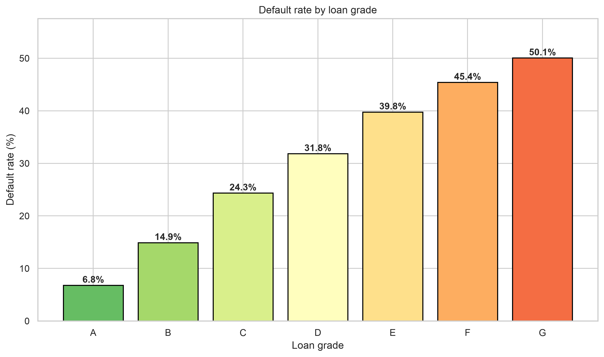
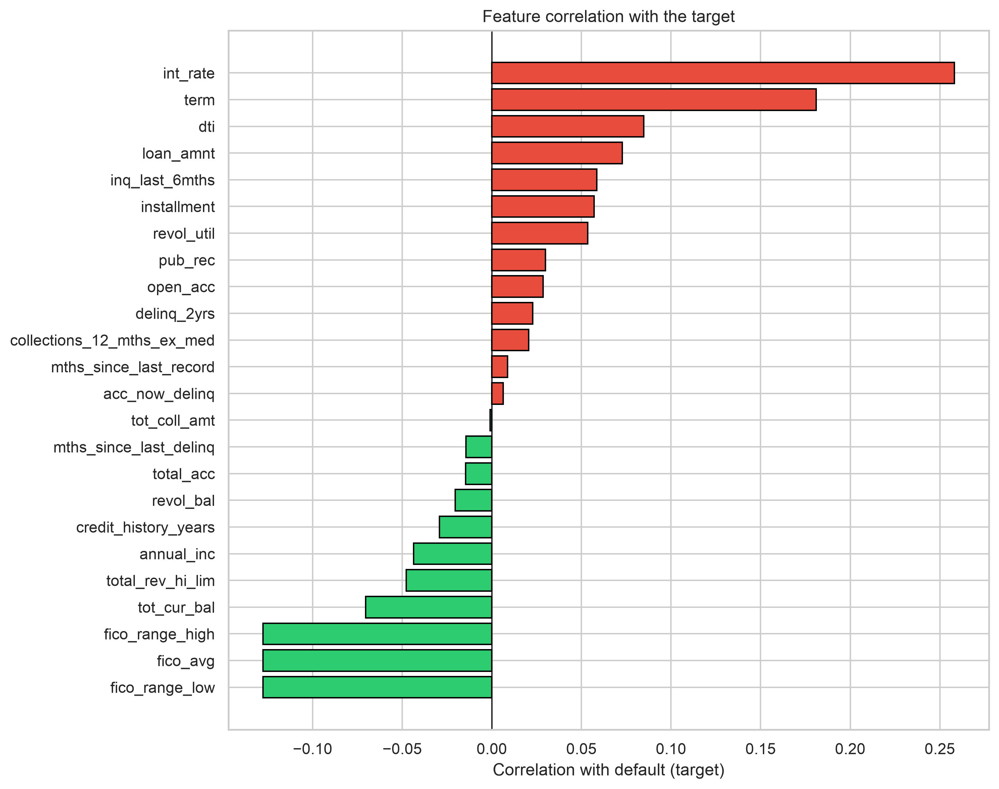
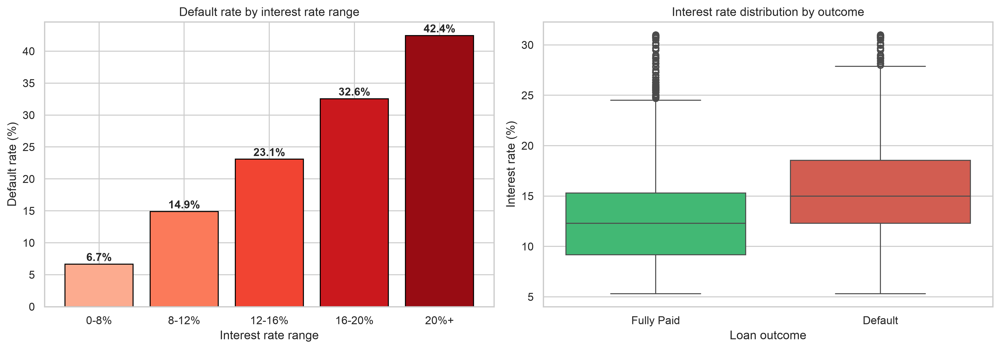

# Credit risk model — Lending Club

I'm Okoene Makuochukwu, a CS student at EPITA. I'm working through Andrew Ng's Machine Learning Specialization (Coursera, Stanford + DeepLearning.AI) and this repo is where I take each week's ideas and try them on a real dataset instead of the course's toy data. Right now it's a credit-risk project on Lending Club loans.

## Where this is right now (October 2026)

Cleaning, EDA, preprocessing and the modeling pass are done. Business-metric work isn't yet — I'm partway through the project and this README reflects what's shipped, not what's planned.

- **Done:** `01_data_cleaning.ipynb`, `02_eda.ipynb`, `03_feature_engineering.ipynb`, `04_modeling.ipynb`.
- **Not yet:** `05_business_metrics.ipynb` (cost-sensitive threshold selection, expected-loss calculation). Next.
- **Headline numbers.** Champion is XGBoost on the 2018 test set (n ≈ 12k, 27% default base rate): ROC-AUC 0.709, PR-AUC 0.452, Brier 0.215. 04 saves the full seven-model comparison to `data/processed/model_metrics.json`.

## The question

Can we predict, at the time a loan is issued, whether a Lending Club borrower will default? It's a binary classification problem, and the thing that makes it interesting is that defaults are rare and the cost of a false negative (approving someone who then defaults) is much larger than the cost of a false positive (rejecting someone who would have paid). Andrew's lecture on skewed classes and the precision-recall tradeoff is more or less the shape of this problem.

## Dataset

Lending Club public loan data, 2007–2018, ~2.26 million rows and 145 columns. I kept 32 of those columns — the ones I thought could plausibly be known at the time of issuance — removed identifiers and post-loan columns like `total_pymnt` and `recoveries` (which would leak the outcome into the features), filtered to loans whose outcome is known (so, dropped "Current"), and took a stratified sample of 250k rows to keep the notebooks responsive on a laptop.

## What I did so far

### 01 — cleaning

Three decisions here were the ones I actually had to think about:

1. **How to define "default".** Lending Club's `loan_status` has about ten values. I grouped `Charged Off`, `Default`, `Late (31–120 days)`, `Late (16–30 days)` and `Does not meet the credit policy. Status:Charged Off` as the positive class. Lumping the "late" statuses in with the actually-charged-off loans is a judgment call — those borrowers aren't technically defaults yet. I chose to include them because for a credit team the operational decision point is "is this loan showing distress", not "has it already failed". I'll revisit this when I look at calibration in 04.
2. **How to sample.** The full set is manageable but slow to iterate on, so I stratified-sampled 250k rows by target. This preserves the class ratio but shrinks the long tail of rare states and purposes — something to keep in mind when the geographic chart in 02 shows noisy tiles for the smaller states.
3. **What to drop as leakage.** Anything that could only exist after the loan matured — `total_pymnt`, `recoveries`, `last_pymnt_*` — came out. Andrew makes a big deal about leakage in the data-preparation lecture; this was the first time I actually had to apply that discipline on real data rather than a cleaned toy dataset.

A fourth decision I had to think about after I'd written the first draft: 01 originally imputed missing values with the median of the whole dataset and computed `credit_history_years` against a hard-coded `2018-12-31` reference date. Both were leakage bugs — the imputation fits parameters on data that would include the test set, and the hard-coded reference lets older loans see into the future. I moved the imputation to 03 (where the train/test split happens first, so the imputer can be fit on train only), and the credit-history calculation now runs as `(issue_d − earliest_cr_line)` per row so it only uses information knowable at origination. Flagging these because catching my own mistakes is the point of this project; they also made Andrew's leakage lecture click properly for me.

### 02 — EDA

The EDA notebook is organized around one question: of the features we kept, which actually separate defaulters from non-defaulters, and by how much?

A few things stood out:

- Grade is the single clearest signal. Default rate climbs almost monotonically from grade A (around 5%) to grade G (around 30%). Lending Club's grade already encodes a lot of what we'd want to learn, so part of what 04 will have to tell us is how much *additional* signal is left in the raw features once grade is in.
- Interest rate tracks default roughly linearly. That's risk-based pricing working as advertised. For modeling, it means `int_rate` and `grade` carry overlapping information — something to think about when I regularize the logistic regression.
- FICO is the obvious inverse. Default rate drops from about 22% at FICO <650 to about 5% at 800+. No surprise, but worth confirming on this specific sample before relying on it.

One thing to flag: I did EDA on the full sampled dataset, not just a training portion. The clean move is to hold out the test set *before* looking at it, so EDA observations can't bias feature choices. 03 redoes the discipline properly from the split onward; I didn't go back and redo 02 against train only, which I'd fix in a cleaner second pass.

### 03 — feature engineering

The whole job of this notebook is the "fit preprocessing on train only" discipline. In order:

1. **Time-aware split by `issue_d`.** 2007–2017 to train, 2018 to test. A random split would be optimistic because credit outcomes drift year to year.
2. **Six row-wise features.** `fico_avg`, `credit_history_years = issue_d − earliest_cr_line`, `loan_to_income`, `monthly_debt_burden`, `emp_length_num`, `grade_num`. All stateless, so I compute them on both sides the same way.
3. **Median imputation**, fit on train only. The first step that fits parameters from data, so the discipline starts here.
4. **One-hot encoding** for `home_ownership`, `verification_status`, `purpose` — fit on train, `handle_unknown='ignore'` for anything the test set has that train didn't.
5. **Smoothed target encoding for `addr_state`** (50 categories): per-state default rate on train, pooled toward the global mean with `k=50`. One-hotting 50 states would be mostly empty columns; the smoothing keeps the small states from being memorized.
6. **StandardScaler** fit on train. Trees don't need it, LR does, so I save both the scaled and unscaled matrices.

Outputs land in `data/processed/`: six CSVs for the feature matrices and targets, plus `preprocessors.joblib` (fitted imputer, encoder, state map, scaler, feature-column list) so 04 or an inference-time script can reproduce the pipeline on new loans.

### 04 — modeling

Four models in a progression, each one answering a specific question:

1. **Majority-class baseline.** Floor every real model has to clear.
2. **Vanilla logistic regression.** First honest number from a model that actually uses the features.
3. **Regularized logistic regression** with `class_weight='balanced'` and L2 strength tuned via grid search + 3-fold stratified CV on PR-AUC. Also where I check the class-imbalance strategy: no-treatment vs `class_weight` vs SMOTE on the same test set.
4. **Random forest and XGBoost.** Tree ensembles to see how much a non-linear model class buys over the LR.

After the tuned LR, a learning curve diagnoses whether the model is capacity-limited (train and validation plateau close together → need a bigger model class) or data-limited (open gap → more training data would help). Andrew's bias-variance framing made concrete on a real dataset.

The champion (by test-set PR-AUC) is saved to `models/best_model.joblib`, with its test-set probabilities saved alongside for 05 to use. The notebook ends with a reliability diagram so 05 knows whether to trust the probabilities at face value when computing expected loss or whether to post-hoc calibrate them first.

## What's coming next

- **05 — business metrics.** Expected loss (PD × LGD × EAD), threshold tuning as a cost-sensitive decision, and a short note on what the model would actually tell a credit team.

## How I'm learning this

I'm working through the second course of the specialization (Advanced Learning Algorithms). The parts of the course that most directly shape what you'll see in this repo:

- **Bias/variance diagnosis via learning curves** — how I'll compare the four models in 04.
- **Cost functions and skewed classes** — why 04 will report PR-AUC alongside ROC-AUC, and why 05 picks the decision threshold on expected cost rather than on the ROC curve's elbow.
- **Regularization** — why I'll start with L2-regularized logistic regression before touching the ensembles.
- **Data leakage** — the two bugs I caught in my own 01 draft, the time-aware split in 03, and the general "fit on train only" rule that shapes every step of 03.

## Running it yourself

See [`HOW_TO_RUN.md`](./HOW_TO_RUN.md).

## A few of the EDA charts

Default rate by grade:

Feature correlation with the target — red raises default risk, green lowers it:

Interest rate against loan outcome:

The interactive versions (grade bar, choropleth, four-panel dashboard) are in `images/` as `.html` files.

## Contact

- GitHub: [@Evelynval-w](https://github.com/Evelynval-w)
- Email: okoeneeve@gmail.com
- LinkedIn: [okoene-makuo-56932b259](https://www.linkedin.com/in/okoene-makuo-56932b259/)
